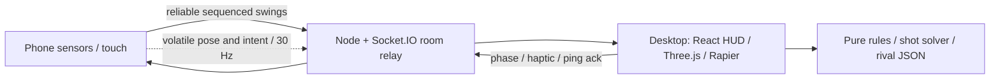

# Dink Duel

Motion-controlled pickleball: the laptop runs a 3D match; the phone is the paddle. Singles against four distinct rivals, with keyboard and touch fallback.


## Run

Node 22.12+ (24 LTS recommended), npm, and a WebGL-capable browser.

```sh
npm ci
npm run dev
```

Open **http://localhost:5173**. Choose **Play with your phone** or **Try with your keyboard**. The relay uses port 3001; Vite proxies WebSockets so both devices share one origin. Use `/c` or the QR link to join. The invite uses the first detected LAN address when opened on localhost; on machines with several adapters, open the correct Vite Network URL on the laptop before pairing.

**Phone motion needs HTTPS.** A plain LAN HTTP URL supports touch only. Use the workflow below for iOS Safari. No application code calls image generation at runtime.

## HTTPS on an iPhone (Windows)

One-time setup in PowerShell (Node 22.12+ and npm must already be installed):

```powershell
winget install --id Cloudflare.cloudflared --exact
# Reopen PowerShell so cloudflared is on PATH.
Set-Location D:/Downloads/coding/game
npm ci
cloudflared --version
```

Start each session:

```powershell
Set-Location D:/Downloads/coding/game
npm run dev:https
```

Stop any existing `npm run dev` first: ports **5173** (Vite 7 / React) and **3001** (Express / Socket.IO relay) must be free. The launcher creates a Cloudflare Quick Tunnel to `http://localhost:5173`, reads its generated HTTPS URL, allows that exact hostname in Vite, and starts both dev servers. Wait for Vite to be ready, then open the printed **HTTPS URL on the laptop**. Choose **Play with your phone** and scan that page's QR with the iPhone camera; open it in Safari. Tap **Tap to enable motion**, allow motion/orientation access, and take three gentle practice swings. Permission requests stay inside that button's user gesture. Touch controls remain available if permission is denied or sensors are unavailable.

The QR and copied invite preserve the public page's current origin, including `/c?room=…`. Socket.IO uses that same origin: HTTPS selects **wss**, HTTP selects **ws**. Cloudflare forwards `/socket.io` to Vite, which proxies WebSocket upgrades to port 3001 while preserving Host/Origin for the relay's origin check. No extra tunnel, public relay port, `ALLOWED_ORIGINS`, certificate installation, Cloudflare account, or phone trust setup is needed. Vite stays on 5173 (`strictPort`) so the tunnel cannot silently point to the wrong port. Leave `PORT` unset or set it to `3001` for this dev workflow.

Keep the terminal open; **Ctrl+C** stops the tunnel and dev servers. Each launch gets a new URL, so reopen it on the laptop and scan the new QR. Do not change `http://192.168.…:5173` to `https://192.168.…:5173`: the local server still speaks HTTP; HTTPS is provided at the tunnel URL. If you see “Motion needs HTTPS,” use the printed public URL and its QR instead of the LAN link.

Troubleshooting: if `cloudflared` is not found, reopen PowerShell after installing it. If a tunnel fails to connect, check Internet/firewall access and its terminal logs. If an existing `%USERPROFILE%/.cloudflared/config.yaml` or `config.yml` interferes with Quick Tunnels, temporarily rename it and restore it afterward. The URL may briefly return 502 while Vite starts; retry after the dev server is ready. If Safari permission was denied, allow Motion & Orientation access in the website settings (or clear the site's permission and try again).

Quick Tunnels expose this development server publicly while running; share the URL only with players and stop it afterward. They require Internet access, add network latency, and have no uptime guarantee. They are appropriate for phone testing; a named tunnel or deployed HTTPS service is better for a stable public game. See Cloudflare's [Quick Tunnel guide](https://developers.cloudflare.com/tunnel/get-started/quick-tunnels/) and [Windows install instructions](https://developers.cloudflare.com/cloudflare-one/networks/connectors/cloudflare-tunnel/downloads/).

## Play

**You aim and time. Your character runs.** Your character automatically runs toward the ball. You decide when to swing and where the ball goes.

1. **Serve.** When the screen says “Your serve,” press **Space** or tap **Swing**. The serve goes diagonally across the net.
2. **Watch the ring.** Green = swing now. Yellow = almost there. Orange = let it bounce first.
3. **Swing once.** Press Space once per swing. Holding Space does not keep swinging.
4. **Aim.** Hold **←** or **→** while pressing Space to aim left or right.

Swinging when the ball is far away costs no point. The character connects when the ball is inside reach. Pressing during an orange/red rule warning causes the indicated fault. Green windows, whiffs, and fault explanations are initially enabled for **Pip + Easy**; see the [rollout and QA notes](docs/swing-clarity-rollout.md).

| Action | Keyboard | When |
| --- | --- | --- |
| Serve or hit | Space, once per swing | Your serve, or when the ring is green |
| Aim left or right | Hold ← / → while pressing Space | At the moment of the swing |
| Pause | P | Any time |
| Soft dink / drop / lob / underspin | C / D / Shift / X + Space | At the moment of the swing |
| Forward / retreat intent | Hold ↑ / ↓ | During play; automatic footwork continues |
| Next point | Enter | After the fault explanation |

On the phone, tap **Swing** when the ring turns green. The button glows and buzzes when it is time, if haptics are enabled and supported. **Drag Aim** to steer. A short tap makes a medium shot; hold and release for a stronger shot; swipe up on Swing for a lob. In motion mode, tilt to aim and swing to hit.

You lose the point if you hit the net or outside the court, let the ball bounce twice on your side, hit the serve or first return before its bounce, or volley while standing in the kitchen next to the net. First to 11 wins, by two points. The point winner serves next.

Auto footwork handles movement to the ball; timing, aim, power, spin and forward/retreat intent remain player decisions. Perfect contacts are within ±45 ms of the ideal contact plane; Good within ±120 ms; late/very early shots lose pace and accuracy. Assisted launch solutions clear the net but do not trigger swings or guarantee that hard/late shots stay in bounds.

Rally challenge, saved personal best and the sunset court unlock are preserved. First-time keyboard play against Pip on Easy starts five guided lessons with repeatable ball-machine feeds. Skip from the first lesson or use **Replay guided practice** from the menu. Progress is stored locally. Other rollout cohorts retain the existing short practice prompts.

Pip is balanced; Rocket favors drives and makes pressure errors; Mabel prefers patient short shots and struggles to retreat against lobs; June is the club champion. All three difficulty settings remain independent of rival choice. Three consecutive wins/losses adjust AI reactions and errors slightly, without changing sensor detection.

## Settings and feedback

- Full-viewport court during play; compact score/rally HUD and edge toasts.
- Match-local longest rally, winners, faults and average accepted-contact timing, with rival quips and rematch.
- 60–75 ms contact hit-stop, recoil, squash, timing ring, pooled particles, speed-scaled trail and landing marker.
- Low/Medium/High quality controls shadow maps, particles and pixel ratio. Reduced motion disables particles, squash and shake and honors the OS preference.
- Master, effects, music and ambience levels; mute. Original synthesized effects and three music stems adapt to rally length. Audio is unlocked only after a user gesture.
- Phone strength arc, tilt indicator, handedness mirroring, six paddle skins and a Settings drawer. Sensor detection is sampled independently of the roughly 30 Hz visual update.
- Wake lock, local swing flash/vibration, separate confirmed-contact haptics, RTT and clock-offset estimation.
- Controller loss pauses play and reserves identity for 60 seconds. Recalibration/reload resumes with the score intact. A temporary laptop transport loss also pauses play and reserves the same room for 60 seconds; after it reconnects, resume from pause. Closing/reloading the laptop page creates a new session. Successful phone-to-screen heartbeats keep a paired room active even without movement.
- Anonymous local tuning data is **off by default** and never leaves the browser. Swing-clarity events use a random session ID and contain no personal data or device IDs. Clear it in Settings.

## Architecture



`shared/src/protocol.ts` contains message types and Zod schemas. `server/src` manages rooms and authorized validated relay only. `web/src/game` owns fixed 120 Hz physics, scoring, timing, spin, AI and sound. `web/src/screen` owns rendering and the desktop interface. `web/src/controller` owns calibration, motion and touch. React does not run the render loop. `web/src/tokens.css` is the typography/color/spacing token source.

The relay uses websocket-only transport, one phone per room, UUID resume tokens, role checks, sequence rejection, an 8 KB packet limit, a 65-packet/second socket limit, 12 join attempts/minute per socket IP, same-origin/allowlist handshakes, and 10-minute inactivity expiry. Behind a reverse proxy the socket IP may group users; use a trusted edge rate limiter for a public multi-user deployment. Rooms and casual scores are not a competitive leaderboard authority.

## Art workflow

Read [the art bible](docs/art-bible.md) and [curation manifest](art/manifest.json). There are four initial candidates for each of 14 jobs, plus one targeted portrait correction: **57 generated candidates**. Four character turnarounds, six skin designs, material tiles, day/sunset plates, UI atlas, logo explorations, app icon, share art and rival portraits are included. The selected images produce 31 downsized runtime asset entries. Models remain procedural 3D, informed by the generated references.

```sh
npm run art:generate -- --dry-run
npm run art:generate -- --asset=style-frame
npm run art:generate -- --asset=concept-pip
npm run art:review
npm run art:process
```

Actual API requests require `OPENAI_API_KEY` in the environment; never put it in source. `OPENAI_IMAGE_MODEL` can override the supported default (`gpt-image-2.5-sunburst`). The runner checks model access, uses generation for the style frame and reference edits for later assets, requests four 1024px PNG candidates and does not automatically select one. `gpt-image-1` is retired; the official source is linked in the art bible.

The included art was generated with the **built-in image tool**, not an account API key. Its underlying model is not exposed; the manifest says so. Exact prompts, requested parameters, dates, hashes, selection reasons and assistant reviewer are stored. Human approval remains explicitly pending.

Edit `art/selections.json` after visual review. Raw discarded candidates remain locally in ignored `art/raw`; four-way review sheets are tracked. Full selected sources are committed under `art/selected/sources`, so `npx tsx scripts/process-art.ts --curated-only` works from a fresh checkout without API access. The processor preserves alpha, trims, constrains palette, downsizes, encodes WebP/AVIF, packs icons, checks tile edges, and emits CSS/TypeScript maps. No raw 1024px art is served in game UI.

## Verification

```sh
npm run check
npm run test:e2e
```

`check` runs TypeScript, lint, Vitest, production build and a bundled-size gate. All **22 baseline tests remain**, with new timing, spin, rival distribution, preferences, contrast, opt-in, art-integrity and touch-gesture tests: **36 tests** total. Seven browser tests cover pairing/calibration/serve/pause/resume, score preservation after reload, keyboard and full-viewport play, graphics/reduced motion, opt-in default, landscape controller layout, rival naming, skin switching, and genuine touchscreen calibration in Chromium and WebKit. Touch releases register without requiring a synthesized click, and the follow-up click cannot count twice.

Local Playwright uses installed Chrome plus WebKit for the Safari controller regression. Install WebKit once with `npx playwright install webkit`. CI installs Chromium and WebKit. Append `?debug=1` for FPS, phase, room and hit count. The budget script counts all JS/CSS chunks including physics and all optional bundled images; external Google Fonts are excluded. Build size is not an FPS or latency measurement.

See [the phase review and before/after captures](docs/implementation-review.md), [voice guide](docs/voice.md), [game design](docs/game-design.md), and [ten-point real-phone checklist](docs/playtest-checklist.md).

## Production

```sh
npm ci
npm run build
npm start
```

One Express service serves the game, assets, `/c`, `/health` and Socket.IO on port 3001. The Dockerfile and push/PR CI are retained. Deploy one Node-capable instance behind a WebSocket-capable HTTPS proxy; rooms are in memory. Choose a nearby region. No deployment provider has been created or configured by this workspace.

| Environment          | Default           | Purpose                                           |
| -------------------- | ----------------- | ------------------------------------------------- |
| `PORT`               | `3001`            | HTTP and WebSocket listener                       |
| `NODE_ENV`           | unset             | Use `production` to disable LAN-address discovery |
| `ALLOWED_ORIGINS`    | same origin       | Comma-separated additional allowed origins        |
| `OPENAI_API_KEY`     | unset             | Optional build-time art generation only           |
| `OPENAI_IMAGE_MODEL` | supported default | Explicit build-time image model                   |

Set variables in the shell/provider; `.env` files are not automatically loaded. Never expose image API credentials to Vite or a `VITE_` variable.

## Open gates and credits

Physical iOS/Android accuracy, sensor behavior when rotating the phone, measured local Wi-Fi response under 100 ms, real integrated-GPU/controller FPS, hosted HTTPS acceptance and human art review remain unverified. The optional replay camera is deferred. The net collider conservatively uses post height across the width; the visible net sags at center. Serves are assisted rather than judging real-world underhand biomechanics.

Generated art and original geometry/audio are project assets. No third-party model/sound packs are bundled. DM Sans, Manrope and IBM Plex Mono use their upstream SIL Open Font Licenses through Google Fonts, with system fallbacks. Dependencies retain upstream licenses and the lockfile pins the tested graph.
