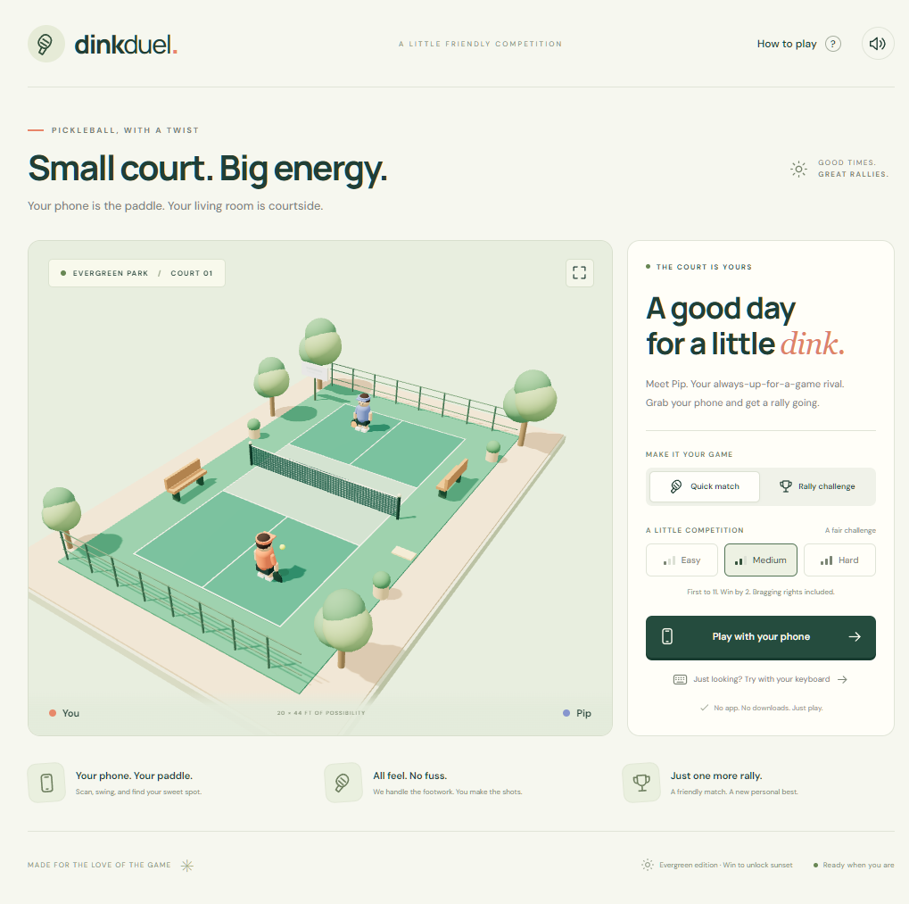
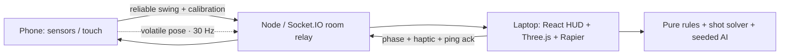

# Dink Duel

**Your phone is the paddle. Your living room is courtside.**

A solo, 3D pickleball game with a motion-controlled phone paddle, a friendly AI rival, and a keyboard fallback. Built from [the implementation plan](docs/Phone-as-Controller%20Game%20Implementation%20Plan.md).



## Run locally

Requires Node.js 22.12+ (Node 24 LTS recommended) and npm.

```sh
npm ci
npm run dev
```

Open **http://localhost:5173** on your laptop. The relay runs on port 3001; Vite proxies the WebSocket connection so both devices use the same origin.

- **Try with your keyboard** starts a match immediately.
- **Play with your phone** shows the QR code and four-letter room code.
- For local touch play, connect your phone to the same Wi-Fi. The QR code uses the first detected LAN address when the laptop is opened on localhost. If your machine has several network adapters, open Vite's correct Network URL on the laptop before pairing.
- A second browser tab at `/controller.html?room=ABCD` works as a test controller. `/c` is the short join page.
- Allow the local dev server through your firewall if another device cannot connect.

### Motion controls require HTTPS

An ordinary `http://192.168…` address supports **touch controls only**. Mobile browsers require a secure context for motion sensors.

Forward Vite's port **5173** through an HTTPS tunnel with WebSocket support, or use a trusted local HTTPS certificate. Open the resulting **public HTTPS address on the laptop first**, then scan its QR code with the phone. This ensures that the page, relay, and invite all use the same address. The game requests motion permission from a button tap, including the iOS permission prompts. If your proxy changes the WebSocket Host header, set `ALLOWED_ORIGINS` to the public HTTPS origin before starting the relay.

Motion calibration is three gentle forehand swings. It learns the dominant rotation axis, forehand sign, neutral tilt, and typical peak speed. Android starts with a lower sensitivity; a slider allows tuning. Use a firm grip or wrist strap and clear the surrounding space. Touch controls remain available when permission is denied or readings are unavailable.

## Controls

| Action         | Phone                                        | Keyboard                  |
| -------------- | -------------------------------------------- | ------------------------- |
| Serve / hit    | Swing, or tap the paddle in touch mode       | Space                     |
| Aim            | Tilt left/right, or use the touch aim slider | Hold ← / → while swinging |
| Power          | Swing speed, or touch power slider           | Medium-power drive        |
| Lob            | Hold LOB while swinging/tapping              | Shift + Space             |
| Pause / resume | Pause button                                 | P                         |

Players move automatically. Shots include dinks, drives, lobs, and high-ball smashes. A 200 ms input buffer accepts slightly early swings; a bounded position history compensates for late arrivals using the measured phone-to-host clock offset. The displayed paddle follows the phone roll.

## What is implemented

- A Three.js park scene with regulation-size court markings, an open mesh net, two animated procedural characters, paddles, ball trail, ground shadow, and predicted landing marker.
- A Rapier dynamic ball with continuous collision detection, quadratic drag, fixed 120 Hz physics, and interpolated rendering. Pixel ratio is capped at 1.75.
- An iterative shot solver using the same velocity update as the live ball. Net clearance is checked while solving; stronger drives use shorter flight times.
- A pure rules state machine: diagonal serves beyond the kitchen, two-bounce rule, kitchen volley faults, line calls, net/out/double-bounce faults, rally scoring to 11, win by two.
- Easy, medium, and hard AI with seeded decisions, limited movement speed, reaction delay, aim error, and occasional missed returns.
- Quick matches, an ongoing rally challenge, locally stored best rally, and a sunset atmosphere unlocked by winning.
- Original synthesized paddle/bounce/net/point audio played through Howler after a user interaction. Mute control and reduced-motion UI support.
- QR pairing, a manual join page, one phone per room, and unguessable controller resume tokens.
- Reliable, sequenced swing events; volatile 30 Hz paddle pose; two-second round-trip/clock measurements; synchronized game phases; hit flashes and best-effort vibration.
- Motion permission, calibration, handedness, sensitivity, touch fallback, screen wake lock, and a 60-second controller reconnect reservation. A match pauses on disconnect and resumes after the paddle confirms readiness. Recalibration preserves the score.
- Shared Zod schemas and TypeScript event contracts; role checks; sequence rejection; 65-packet/second socket limit; 12 join attempts/minute per socket IP; 8 KB message limit; same-origin/allowlist WebSocket handshake; 10-minute room inactivity expiry; `/health` endpoint.

The court, players, animation, and paddle are **code-generated 3D assets**, rather than downloaded glTF files. This keeps the art consistent and avoids external model downloads or license uncertainty. Image generation is not required for the current art direction; generated character portraits or textures can be added separately without changing the game logic.

The net collider currently uses the regulation post height across the width, while the visual net sags at the center. This conservative approximation is a tuning item for real-device playtests. Serves are assisted to a legal diagonal landing rather than judging the biomechanics of an underhand gesture.

## Architecture



```text
shared/src/protocol.ts        Shared message types and runtime schemas
server/src/index.ts           HTTP service, validated and authorized relay
server/src/rooms.ts           Pairing, identity, reservation and room expiry
web/src/game/engine.ts        Fixed-step match orchestration and input buffering
web/src/game/rules.ts         Pure rules and scoring state machine
web/src/game/solver.ts        Shared trajectory integrator and shot solver
web/src/game/tuning.ts        Court dimensions, physics and AI constants
web/src/game/audio.ts         Original PCM sound synthesis and Howler playback
web/src/screen/scene.ts       Procedural court, characters, effects, camera
web/src/screen/main.tsx       Laptop menus, pairing, scoreboard and HUD
web/src/controller/           Motion detector and mobile controller
tests/                       Logic, physics, full matches and relay integration
tests/e2e/                   Two-browser pairing, controls and reconnect tests
```

React does not run the render/physics loop. The relay never runs the match. This is deliberately a single-instance casual game: scores supplied by a browser should not be trusted for a competitive leaderboard.

### Three implementation decisions

1. **Reliable gestures, disposable poses.** A dropped swing loses a point, so swings use reliable Socket.IO delivery and increasing sequence numbers. Poses can use volatile transport because the next frame replaces a lost one. Inputs are sent only while connected to avoid replaying stale swings.
2. **Aim at a landing point.** Tilt selects a court target, then the solver corrects launch velocity under drag and checks net clearance. Tests cover both the prediction integrator and an actual Rapier trajectory, preventing tests that validate only an unrelated approximation.
3. **Reserve identity on disconnect.** A cryptographically random UUID identifies the controller independently of its socket ID. The reservation lasts 60 seconds, blocks a second phone, pauses the match, and restores control without resetting the score. A lost laptop connection closes its room.

## Checks

```sh
npm run typecheck
npm run lint
npm test
npm run build
npm run test:e2e
```

`npm run check` runs typecheck, lint, Vitest, and the production build. Local browser tests use installed Google Chrome. In CI they use Playwright Chromium; the workflow installs it first. To use another local Playwright channel, adjust `playwright.config.ts`.

The automated suite covers:

- 1,000 seeded targets landing within 5 cm and clearing the net, plus an actual Rapier flight comparison.
- Scripted serve, two-bounce, kitchen, out, net, double-bounce and win-by-two rules.
- Synthetic sensor peak detection, return-motion suppression, calibration and neutral tilt.
- Full physics-driven matches reaching game over on all three difficulties.
- Real socket pairing, validation, duplicate rejection, second-phone rejection, resume and host closure.
- Two browser contexts pairing, touch calibration, serve, pause/resume, reload/recalibration with score preservation, keyboard controls and narrow-screen overflow.

Append `?debug=1` to show FPS, phase, room and successful hits. The displayed ping is the measured round-trip time; no latency benchmark is claimed.

## Production

```sh
npm ci
npm run build
npm start
```

The single Express service serves `web/dist`, `/c`, `/health`, and Socket.IO at **http://localhost:3001**. Put it behind an HTTPS reverse proxy that supports WebSocket upgrades, or deploy the included Dockerfile to a Node-capable service. Run **one instance**; rooms are in memory. Use an Asian region for players in the Philippines.

| Environment       | Default     | Purpose                                                       |
| ----------------- | ----------- | ------------------------------------------------------------- |
| `PORT`            | `3001`      | HTTP and WebSocket listener                                   |
| `NODE_ENV`        | unset       | Set to `production`; disables local network-address discovery |
| `ALLOWED_ORIGINS` | same origin | Comma-separated extra allowed WebSocket origins               |

See `.env.example`. Environment variables must be set by your shell or hosting provider; the server does not automatically load `.env` files. No secrets are required. The per-IP join limiter uses the actual socket address; behind a proxy it may group users under the proxy's IP. Configure a trusted edge rate limiter for a public multi-user deployment rather than trusting arbitrary forwarded headers.

GitHub Actions runs all checks and browser tests on pushes and pull requests. Deployment is intentionally provider-neutral: connect your chosen service to the repository and configure its build/start commands or Docker build. No hosted service has been created from this workspace.

## Remaining real-world gates

The code implements the playable MVP, but these acceptance criteria require physical devices or external services and are **not marked as measured or completed**:

- iPhone Safari, Android Chrome and older-device playtests; recorded real sensor replay fixtures; 95% detection and false-positive targets.
- Measured swing-to-hit latency, added-delay network tests, and Wi-Fi/airplane-mode reconnect timing on actual phones.
- Five-minute physics stress run, integrated-GPU 60 FPS profiling, Safari/Firefox checks and three-player usability sessions.
- Hosted HTTPS URL, provider-specific automatic deployment, external uptime monitor and a two-phone hosted acceptance pass.
- A 30-second real-device demo video, GIF, and published portfolio write-up.

## Credits

All court geometry, characters, paddle artwork and synthesized audio were created for this project. No third-party model or sound packs are bundled. DM Sans and Manrope are loaded from Google Fonts under their SIL Open Font Licenses, with system fallbacks if unavailable. Runtime dependencies retain their upstream licenses; npm's lockfile pins the tested dependency graph.
