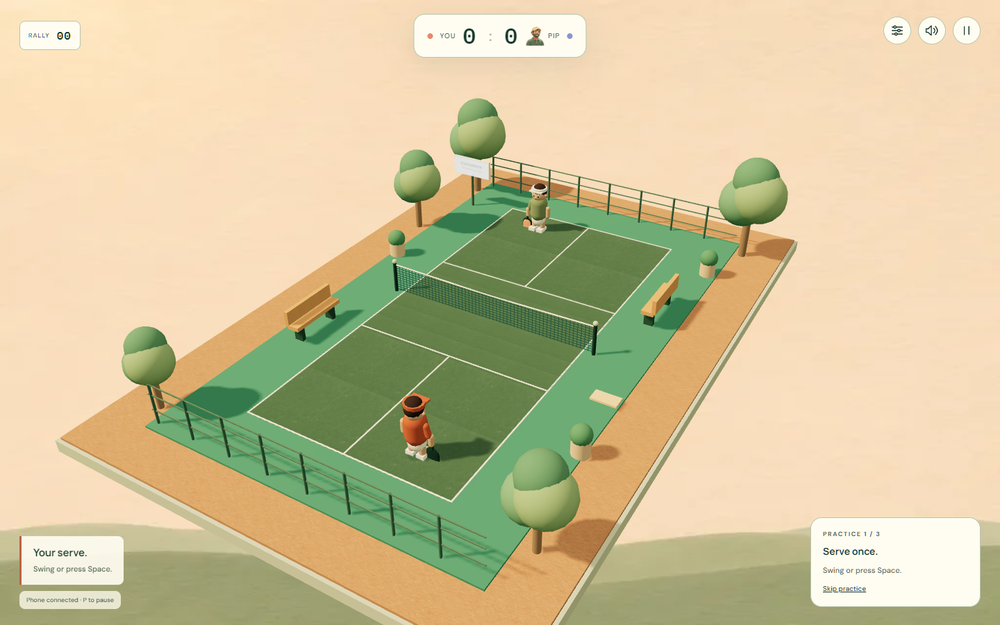
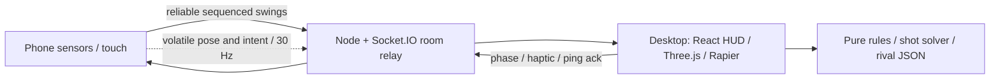

# Dink Duel

Motion-controlled pickleball: the laptop runs a 3D match; the phone is the paddle. Singles against four distinct rivals, with keyboard and touch fallback.



## Run

Node 22.12+ (24 LTS recommended), npm, and a WebGL-capable browser.

```sh
npm ci
npm run dev
```

Open **http://localhost:5173**. Choose **Play with your phone** or **Try with your keyboard**. The relay uses port 3001; Vite proxies WebSockets so both devices share one origin. Use `/c` or the QR link to join. The invite uses the first detected LAN address when opened on localhost; on machines with several adapters, open the correct Vite Network URL on the laptop before pairing.

**Phone motion needs HTTPS.** A plain LAN HTTP URL supports touch only. Forward port 5173 through an HTTPS tunnel with WebSocket support, or use a trusted local certificate. Open the HTTPS address on the laptop first, then scan its QR. If the proxy rewrites the WebSocket Host header, add the public HTTPS origin to `ALLOWED_ORIGINS`. No application code calls image generation at runtime.

## Play

| Action      | Phone                                            | Keyboard                                |
| ----------- | ------------------------------------------------ | --------------------------------------- |
| Hit / serve | Swing, or tap the paddle                         | Space                                   |
| Aim         | Tilt; slide the touch paddle                     | Hold ← / → while hitting                |
| Power       | Swing speed; move while holding the touch paddle | Medium drive; C + Space for a soft dink |
| Drop        | Toggle DROP, then hit                            | D + Space                               |
| Lob         | Hold LOB while hitting                           | Shift + Space                           |
| Position    | Forward/back tilt or ADVANCE / RETREAT hold      | Hold ↑ / ↓                              |
| Underspin   | Backhand swing                                   | X + Space                               |
| Pause       | Small pause control                              | P                                       |
| Next point  | Desktop toast button                             | Enter                                   |

Auto footwork handles movement to the ball; timing, aim, power, spin and forward/retreat intent remain player decisions. Perfect contacts are within ±45 ms of the ideal contact plane; Good within ±120 ms; late/very early shots lose pace and accuracy. Assisted launch solutions clear the net but do not trigger swings or guarantee that hard/late shots stay in bounds.

Rally scoring goes to 11, win by two. Diagonal serves, the two-bounce rule, line calls, kitchen volley faults, net/out/double-bounce faults remain. Rally challenge, saved personal best and the sunset court unlock are preserved. A short first-time practice prompt teaches serve, dink and lob; it is skippable and capped at 30 seconds.

Pip is balanced; Rocket favors drives and makes pressure errors; Mabel prefers patient short shots and struggles to retreat against lobs; June is the club champion. All three difficulty settings remain independent of rival choice. Three consecutive wins/losses adjust AI reactions and errors slightly, without changing sensor detection.

## Settings and feedback

- Full-viewport court during play; compact score/rally HUD and edge toasts.
- Match-local longest rally, winners, faults and average accepted-contact timing, with rival quips and rematch.
- 60–75 ms contact hit-stop, recoil, squash, timing ring, pooled particles, speed-scaled trail and landing marker.
- Low/Medium/High quality controls shadow maps, particles and pixel ratio. Reduced motion disables particles, squash and shake and honors the OS preference.
- Master, effects, music and ambience levels; mute. Original synthesized effects and three music stems adapt to rally length. Audio is unlocked only after a user gesture.
- Phone strength arc, tilt indicator, handedness mirroring, six paddle skins and a Settings drawer. Sensor detection is sampled independently of the roughly 30 Hz visual update.
- Wake lock, local swing flash/vibration, separate confirmed-contact haptics, RTT and clock-offset estimation.
- Controller loss pauses play and reserves identity for 60 seconds. Recalibration/reload resumes with the score intact; laptop loss closes the room.
- Anonymous local tuning counters are **off by default**, never leave the browser, contain no identifiers, and can be cleared in Settings.

## Architecture



`shared/src/protocol.ts` contains message types and Zod schemas. `server/src` manages rooms and authorized validated relay only. `web/src/game` owns fixed 120 Hz physics, scoring, timing, spin, AI and sound. `web/src/screen` owns rendering and the desktop interface. `web/src/controller` owns calibration, motion and touch. React does not run the render loop. `web/src/tokens.css` is the typography/color/spacing token source.

The relay uses websocket-only transport, one phone per room, UUID resume tokens, role checks, sequence rejection, an 8 KB packet limit, a 65-packet/second socket limit, 12 join attempts/minute per socket IP, same-origin/allowlist handshakes, and 10-minute inactivity expiry. Behind a reverse proxy the socket IP may group users; use a trusted edge rate limiter for a public multi-user deployment. Rooms and casual scores are not a competitive leaderboard authority.

## Art workflow

Read [the art bible](docs/art-bible.md) and [curation manifest](art/manifest.json). There are four initial candidates for each of 14 jobs, plus one targeted portrait correction: **57 generated candidates**. Four character turnarounds, six skin designs, material tiles, day/sunset plates, UI atlas, logo explorations, app icon, share art and rival portraits are included. The selected images produce 31 downsized runtime asset entries. Models remain procedural 3D, informed by the generated references.

```sh
npm run art:generate -- --dry-run
npm run art:generate -- --asset=style-frame
npm run art:generate -- --asset=concept-pip
npm run art:review
npm run art:process
```

Actual API requests require `OPENAI_API_KEY` in the environment; never put it in source. `OPENAI_IMAGE_MODEL` can override the supported default (`gpt-image-2.5-sunburst`). The runner checks model access, uses generation for the style frame and reference edits for later assets, requests four 1024px PNG candidates and does not automatically select one. `gpt-image-1` is retired; the official source is linked in the art bible.

The included art was generated with the **built-in image tool**, not an account API key. Its underlying model is not exposed; the manifest says so. Exact prompts, requested parameters, dates, hashes, selection reasons and assistant reviewer are stored. Human approval remains explicitly pending.

Edit `art/selections.json` after visual review. Raw discarded candidates remain locally in ignored `art/raw`; four-way review sheets are tracked. Full selected sources are committed under `art/selected/sources`, so `npx tsx scripts/process-art.ts --curated-only` works from a fresh checkout without API access. The processor preserves alpha, trims, constrains palette, downsizes, encodes WebP/AVIF, packs icons, checks tile edges, and emits CSS/TypeScript maps. No raw 1024px art is served in game UI.

## Verification

```sh
npm run check
npm run test:e2e
```

`check` runs TypeScript, lint, Vitest, production build and a bundled-size gate. All **22 baseline tests remain**, with new timing, spin, rival distribution, preferences, contrast, opt-in and art-integrity tests: **33 tests** total. Four browser tests cover pairing/calibration/serve/pause/resume, score preservation after reload, keyboard and full-viewport play, graphics/reduced motion, opt-in default, landscape controller layout, rival naming and skin switching.

Local Playwright uses installed Chrome. CI installs its Chromium runtime. Append `?debug=1` for FPS, phase, room and hit count. The budget script counts all JS/CSS chunks including physics and all optional bundled images; external Google Fonts are excluded. Build size is not an FPS or latency measurement.

See [the phase review and before/after captures](docs/implementation-review.md), [voice guide](docs/voice.md), [game design](docs/game-design.md), and [ten-point real-phone checklist](docs/playtest-checklist.md).

## Production

```sh
npm ci
npm run build
npm start
```

One Express service serves the game, assets, `/c`, `/health` and Socket.IO on port 3001. The Dockerfile and push/PR CI are retained. Deploy one Node-capable instance behind a WebSocket-capable HTTPS proxy; rooms are in memory. Choose a nearby region. No deployment provider has been created or configured by this workspace.

| Environment          | Default           | Purpose                                           |
| -------------------- | ----------------- | ------------------------------------------------- |
| `PORT`               | `3001`            | HTTP and WebSocket listener                       |
| `NODE_ENV`           | unset             | Use `production` to disable LAN-address discovery |
| `ALLOWED_ORIGINS`    | same origin       | Comma-separated additional allowed origins        |
| `OPENAI_API_KEY`     | unset             | Optional build-time art generation only           |
| `OPENAI_IMAGE_MODEL` | supported default | Explicit build-time image model                   |

Set variables in the shell/provider; `.env` files are not automatically loaded. Never expose image API credentials to Vite or a `VITE_` variable.

## Open gates and credits

Physical iOS/Android accuracy, sensor behavior when rotating the phone, measured local Wi-Fi response under 100 ms, real integrated-GPU/controller FPS, hosted HTTPS acceptance and human art review remain unverified. The optional replay camera is deferred. The net collider conservatively uses post height across the width; the visible net sags at center. Serves are assisted rather than judging real-world underhand biomechanics.

Generated art and original geometry/audio are project assets. No third-party model/sound packs are bundled. DM Sans, Manrope and IBM Plex Mono use their upstream SIL Open Font Licenses through Google Fonts, with system fallbacks. Dependencies retain upstream licenses and the lockfile pins the tested graph.
