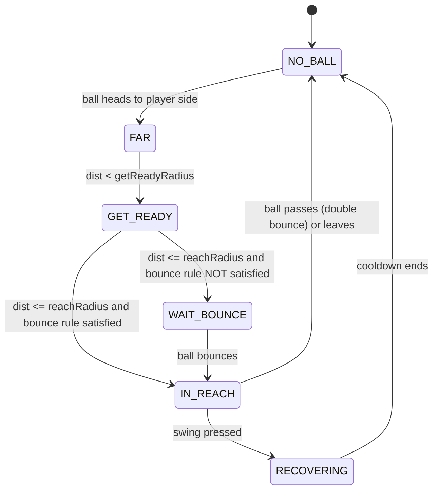

# Swing Clarity: Implementation Spec

| | |
|---|---|
| **Feature** | Reach Ring, Swing Readiness States, Fault Explanations, Guided Practice |
| **Status** | Implemented; human QA and rollout approval pending |
| **Priority** | P0 (onboarding blocker) |
| **Owner** | Gameplay / UI |
| **Affects** | Laptop client (renderer, HUD), phone controller, instructions copy, tutorial flow |
| **Target** | Pip + Easy first, then roll out to all characters and difficulties |

---

## 1. Problem Statement

New players do not understand the split between **automatic movement** and **manual hitting**.

Observed confusion:

1. Players press Swing when the ball is far away and nothing happens. They assume the game is broken or laggy.
2. Players assume the character will swing for them, because the character already runs to the ball.
3. Players hit the serve or first return before it bounces, then get a fault they did not see coming.
4. Players hit from the kitchen before the bounce and cannot tell why they lost the point.
5. "Aim" and "move" are treated as the same thing.

**Root cause:** The game never tells the player *right now* whether a swing will work, and it never says *why* a swing failed. The written instructions explain the rules, but the game does not show them during play.

---

## 2. Goals and Non-Goals

### Goals
- The player can tell at a glance whether pressing Swing will connect.
- Every failed swing and every fault gives a one-line reason.
- A first-time player completes a rally within 3 minutes without reading the manual.
- Rewrite the instructions around one mental model: **"You aim and time. The character runs."**

### Non-Goals
- No change to ball physics, scoring, or AI difficulty.
- No change to the automatic movement algorithm.
- No new input methods.

---

## 3. Core Concept: Swing Readiness

Every frame, the game computes one **SwingReadiness** state for the human player. All visuals, audio, haptics, and text read from this single state. There is one source of truth and no per-widget logic.

### 3.1 States

| State | Meaning | Swing result |
|---|---|---|
| `NO_BALL` | Ball is dead or not heading toward the player | Whiff (no-op) |
| `WAIT_BOUNCE` | Ball has not bounced yet and the rules require a bounce | **Fault if swung** |
| `WAIT_KITCHEN` | Player is in the kitchen and the ball has not bounced | **Fault if swung** |
| `FAR` | Ball is incoming but outside reach | Whiff |
| `GET_READY` | Ball is close to the reach radius | Whiff (early) |
| `IN_REACH` | Ball is inside the reach radius and the rules allow a hit | **Hit** |
| `RECOVERING` | Short cooldown after a swing | Ignored |

State priority, evaluated top to bottom (first match wins):

```
RECOVERING → NO_BALL → WAIT_KITCHEN → WAIT_BOUNCE → IN_REACH → GET_READY → FAR
```

Rule-based blocks (`WAIT_*`) outrank distance, so the player is warned about a fault even when the ball is close.

### 3.2 State machine



---

## 4. Rules Engine Contract

The readiness evaluator must use the **same** rule checks the referee uses. No duplicated logic. If the HUD says "SWING NOW" and the referee then calls a fault, that is a bug.

### 4.1 Types

```ts
export type SwingReadiness =
  | 'NO_BALL'
  | 'FAR'
  | 'GET_READY'
  | 'IN_REACH'
  | 'WAIT_BOUNCE'
  | 'WAIT_KITCHEN'
  | 'RECOVERING';

export interface ReadinessSnapshot {
  state: SwingReadiness;
  distance: number;        // world units, ball to paddle contact point
  reachRadius: number;     // resolved from difficulty and character
  getReadyRadius: number;  // reachRadius * config.getReadyMultiplier
  timeToReach: number | null; // seconds until ball enters reach, null if unknown
  blockReason: BlockReason | null;
}

export type BlockReason =
  | 'SERVE_MUST_BOUNCE'
  | 'RETURN_MUST_BOUNCE'
  | 'KITCHEN_VOLLEY';
```

### 4.2 Evaluator

```ts
export function evaluateReadiness(ctx: MatchContext, cfg: ReadinessConfig): ReadinessSnapshot {
  const { ball, player, rally, now } = ctx;
  const reach = resolveReachRadius(player, ctx.difficulty, cfg);
  const getReady = reach * cfg.getReadyMultiplier;

  const snap = (state: SwingReadiness, extra: Partial<ReadinessSnapshot> = {}): ReadinessSnapshot => ({
    state,
    distance: dist(ball.pos, player.contactPoint),
    reachRadius: reach,
    getReadyRadius: getReady,
    timeToReach: estimateTimeToReach(ball, player, reach),
    blockReason: null,
    ...extra,
  });

  if (now < player.swingCooldownUntil) return snap('RECOVERING');
  if (!ball.alive || !ball.headingToward(player.side)) return snap('NO_BALL');

  const d = dist(ball.pos, player.contactPoint);

  // Rule blocks come first. The player must be told BEFORE they fault.
  if (d <= getReady) {
    if (rally.mustBounceBeforeHit(player.side) && !ball.bouncedOnSide(player.side)) {
      const reason: BlockReason = rally.shotNumber === 1 ? 'SERVE_MUST_BOUNCE' : 'RETURN_MUST_BOUNCE';
      return snap('WAIT_BOUNCE', { blockReason: reason });
    }
    if (player.inKitchen && !ball.bouncedOnSide(player.side)) {
      return snap('WAIT_KITCHEN', { blockReason: 'KITCHEN_VOLLEY' });
    }
  }

  if (d <= reach) return snap('IN_REACH');
  if (d <= getReady) return snap('GET_READY');
  return snap('FAR');
}
```

### 4.3 Hysteresis (prevents flicker)

The ball moves fast. Without hysteresis, the ring can flicker at the boundary.

- Enter `IN_REACH` at `d <= reachRadius`.
- Leave `IN_REACH` only at `d > reachRadius * 1.08`.
- A state must hold for at least 2 frames (about 33 ms at 60 fps) before the HUD changes. Exception: `IN_REACH` appears immediately, so the player never loses a valid window.

> **Important:** Hysteresis is for *display only*. Hit validation uses the raw `d <= reachRadius` check at the moment of input, so display lag can never cause a missed hit.

---

## 5. Player-Facing Feedback

### 5.1 Reach Ring (laptop)

A ring drawn on the ground around the player character.

| State | Ring color | Ring style | Ball marker |
|---|---|---|---|
| `FAR` | Grey 30% | Thin, static | None |
| `GET_READY` | Yellow | Thin, slow pulse | Dotted line from ball to ring |
| `IN_REACH` | Green | Thick, solid, glow | Ball outlined green |
| `WAIT_BOUNCE` | Orange | Thin, with a small bounce icon | Ball outlined orange |
| `WAIT_KITCHEN` | Red | Dashed, kitchen zone tinted | Ball outlined red |
| `RECOVERING` | White 50% | Fades out | None |

**Never rely on color alone.** Each state also has a distinct ring pattern and a text label (see 5.2).

```ts
// ring.ts: render step
export function drawReachRing(g: Graphics, snap: ReadinessSnapshot, player: Player, t: number) {
  const style = RING_STYLES[snap.state];
  g.clear();
  g.lineStyle(style.width, style.color, style.alpha * pulse(style.pulseHz, t));
  if (style.dash) drawDashedCircle(g, player.pos, snap.reachRadius, style.dash);
  else g.drawCircle(player.pos.x, player.pos.y, snap.reachRadius);
  if (snap.state === 'IN_REACH') drawGlow(g, player.pos, snap.reachRadius, style.color);
}
```

### 5.2 Status Prompt (laptop HUD)

A single line, centered below the court, 28 px or larger.

| State | Text |
|---|---|
| `FAR` | `Ball coming. You run, you swing when it's close.` |
| `GET_READY` | `Get ready…` |
| `IN_REACH` | **`SWING NOW`** |
| `WAIT_BOUNCE` | `Let it bounce first` |
| `WAIT_KITCHEN` | `In the kitchen. Wait for the bounce.` |
| `NO_BALL` | *(hidden)* |

Rules:
- Only one prompt is visible at a time.
- The long `FAR` text shows only for the first 5 points. After that, it is replaced with `Waiting…` or hidden.
- `SWING NOW` is the only prompt that gets sound.

### 5.3 Phone controller

The phone mirrors the state so players can look at the phone without looking away from the ball.

| State | Swing button | Haptic | Label |
|---|---|---|---|
| `FAR` / `NO_BALL` | Dim, outlined | None | `Swing (ball too far)` |
| `GET_READY` | Yellow outline | Light tick | `Almost…` |
| `IN_REACH` | Bright green, full fill | Single medium pulse on entry | `SWING` |
| `WAIT_BOUNCE` / `WAIT_KITCHEN` | Orange, lock icon | None | `Wait for bounce` |

**The button stays tappable in every state.** Dimming is an indicator, not a lock. A hard lock would make players think the phone froze.

Sync message (laptop → phone, send on state change and also at 10 Hz as a keepalive):

```json
{
  "type": "readiness",
  "seq": 1042,
  "state": "IN_REACH",
  "blockReason": null,
  "timeToReachMs": 0
}
```

Drop any message with `seq` lower than the last one received.

### 5.4 Whiff feedback (swing out of reach)

When Swing is pressed in `FAR`, `GET_READY`, or `NO_BALL`:

1. Play the swing animation anyway (the player did swing).
2. Play a soft "air swish" sound.
3. Show a small toast near the character: `Too far`, `Too early`, or `No ball`.
4. Apply a short cooldown (see 7) so mashing does not help.
5. **No point penalty.**

| State when pressed | Toast |
|---|---|
| `FAR` | `Too far. Wait for the ring to glow.` |
| `GET_READY` | `Too early. Wait for green.` |
| `NO_BALL` | `No ball to hit` |

### 5.5 Fault explanation

Every lost point shows a 1.2 second freeze-frame card. It names the cause and highlights it on court.

| Fault | Card text | Court highlight |
|---|---|---|
| Net | `Hit the net` | Net flashes |
| Out | `Landed outside the court` | Landing spot marked with an X |
| Double bounce | `Bounced twice on your side` | Both bounce spots marked 1 and 2 |
| Early serve hit | `Serve must bounce before you hit it` | Ball marked at the hit position |
| Early return hit | `First return must bounce before you hit it` | Ball marked at the hit position |
| Kitchen volley | `Kitchen: no hitting before the bounce` | Kitchen zone tinted red |

```ts
export type FaultReason =
  | 'NET' | 'OUT' | 'DOUBLE_BOUNCE'
  | 'EARLY_SERVE_HIT' | 'EARLY_RETURN_HIT' | 'KITCHEN_VOLLEY';

export const FAULT_COPY: Record<FaultReason, string> = {
  NET: 'Hit the net',
  OUT: 'Landed outside the court',
  DOUBLE_BOUNCE: 'Bounced twice on your side',
  EARLY_SERVE_HIT: 'Serve must bounce before you hit it',
  EARLY_RETURN_HIT: 'First return must bounce before you hit it',
  KITCHEN_VOLLEY: 'Kitchen: no hitting before the bounce',
};
```

The referee emits `{ reason, ballPos, bounces[] }`. The UI layer renders it. The referee does no UI work.

---

## 6. Guided Practice (first-run flow)

Triggered the first time the player picks **Try with your keyboard → Pip → Easy**. Skippable from step 1, and re-playable from the menu.

| Step | Goal | What the player does | Pass condition | On-screen coach line |
|---|---|---|---|---|
| 1 | Learn who moves | Watch Pip run to a fed ball | Ball reaches ring | `Pip runs for you. You just choose when to swing.` |
| 2 | Learn the ring | Press Space when ring turns green | 1 clean hit | `Press Space when the ring turns green.` |
| 3 | Learn "too far" | Instructed to press Space early | 1 whiff seen | `Try pressing now. See? Too early does nothing. No penalty.` |
| 4 | Learn the bounce | Serve, then return after the bounce | 1 valid return | `The first return must bounce. Wait for orange to become green.` |
| 5 | Learn aim | Hold ← or → while swinging | 2 hits on the chosen side | `Hold ← or → while you press Space.` |

Implementation notes:
- Feed balls from a deterministic **ball machine** (scripted trajectory), not the AI, so steps are repeatable.
- Each step has a 20 second hint timer. If the player has not passed, escalate to a larger coach line and an arrow pointing at the ring.
- Step 3 is intentional. Letting players whiff safely teaches the rule faster than explaining it.
- Persist progress under `tutorial.completedSteps` in local storage. Fail silently if storage is unavailable.

---

## 7. Configuration

All tunables live in one data file so design can iterate without code changes.

```jsonc
// config/readiness.json
{
  "getReadyMultiplier": 1.6,
  "hysteresisExit": 1.08,
  "minStateFrames": 2,
  "reachRadius": {
    "easy":   { "base": 1.35 },
    "normal": { "base": 1.10 },
    "hard":   { "base": 0.90 }
  },
  "characterReachBonus": { "pip": 0.15 },
  "whiffCooldownMs": { "easy": 250, "normal": 350, "hard": 450 },
  "hitCooldownMs": 200,
  "faultCardMs": 1200,
  "longHintPointsShown": 5,
  "haptics": { "enterReachMs": 25, "getReadyMs": 8 }
}
```

`reachRadius` is the *real* hit radius and also the ring size. They must never be set independently.

```ts
function resolveReachRadius(p: Player, diff: Difficulty, cfg: ReadinessConfig): number {
  return cfg.reachRadius[diff].base + (cfg.characterReachBonus[p.id] ?? 0);
}
```

---

## 8. Updated Instructions Copy

Replace the current "How to play" block with the text below. It leads with the mental model and moves the rules into short blocks.

> ### How to play
>
> **You aim and time. Your character runs.**
>
> Your character automatically runs toward the ball. You decide **when to swing** and **where the ball goes**.
>
> **1. Serve.** When the screen says "Your serve," press **Space** (or tap Swing on your phone). The serve goes diagonally across the net.
>
> **2. Watch the ring.** A ring appears around your character.
> - **Green ring = swing now.**
> - **Yellow = almost there.**
> - **Orange = let it bounce first.**
>
> **3. Swing once.** Press **Space** once per swing. Holding Space does not keep swinging.
>
> **4. Aim.** Hold **←** or **→** while you press Space to aim left or right.
>
> **Swinging when the ball is far away does nothing, and it doesn't cost you a point.** The character only hits when the ball is inside the ring.
>
> **You lose the point if you:**
> - Hit the ball into the net or outside the court.
> - Let it bounce twice on your side.
> - Hit the serve or first return before it bounces.
> - Hit the ball before it bounces while standing in the kitchen (next to the net).
>
> First to 11 wins, by 2 points. The point winner serves next.

Controls table (unchanged keys, added "when" column):

| Action | Control | When |
|---|---|---|
| Serve or hit | **Space** (once per swing) | When the ring is green |
| Aim left or right | Hold **←** / **→** while pressing Space | At the moment of the swing |
| Pause | **P** | Any time |

Phone-specific lines:
- Tap **Swing** when the ring turns green. The button glows and buzzes when it is time.
- Drag **Aim** to steer. Short tap = medium shot. Hold and release = stronger shot. Swipe up on Swing = high lob.

---

## 9. Audio

| Event | Sound | Notes |
|---|---|---|
| Enter `IN_REACH` | Short rising blip | Plays once per ball. Never repeats. |
| Whiff | Soft air swish | Lower volume than a real hit |
| Fault | Short descending tone | Plays with the fault card |
| Hit | Existing paddle hit | Unchanged |

Add a settings toggle: **"Swing cue sound."** Default on.

---

## 10. Accessibility

- All states differ by **shape and text**, not color alone (dashed vs solid vs thick, plus a label).
- Provide a **High Contrast Ring** option, with thicker lines and white and black outlines.
- Respect **Reduce Motion**: replace pulses with static rings, and make the fault card a fade instead of a freeze with zoom.
- Haptics are optional. The phone shows the same cues visually.
- Prompt text meets a 4.5:1 contrast ratio against the court background. Use a dark text plate behind it.

---

## 11. Telemetry

Log with a session ID, no personal data.

| Event | Fields |
|---|---|
| `whiff` | state, distance, difficulty, pointIndex |
| `fault` | reason, shotNumber, readinessStateAtSwing |
| `swing_in_reach` | timeSinceInReachMs (reaction delay) |
| `tutorial_step` | step, attempts, durationMs, skipped |
| `first_rally_complete` | secondsSinceFirstLaunch |

### Success metrics (compare 2 weeks before vs after)

| Metric | Target |
|---|---|
| Whiffs per player in the first 5 points | **-50%** |
| Early-hit faults (serve / return / kitchen) in first 10 points | **-60%** |
| Time to first completed rally | **under 3 minutes (median)** |
| Tutorial skip rate | under 40% |
| Players who quit within 2 minutes of first launch | **-30%** |

---

## 12. Edge Cases

| Case | Expected behavior |
|---|---|
| Ball is in reach for under 100 ms (very fast shot) | `IN_REACH` shows immediately. Haptic and sound still fire. |
| Player presses Swing on the same frame the ball enters reach | Raw distance check at input time decides. Count as a hit. |
| Player presses Swing during `RECOVERING` | Ignored. Do not queue. |
| Input buffering | Allow a **80 ms** buffer. A press up to 80 ms *before* `IN_REACH` is applied the moment the state becomes `IN_REACH`. This applies only to `GET_READY` presses, never to `WAIT_*`. |
| Pause during a rally | Freeze state timers. On resume, re-evaluate readiness before accepting input. |
| Phone disconnects mid-rally | Laptop shows `Controller lost`, auto-pauses. Keyboard stays active. |
| Phone latency over 120 ms | Phone shows a small latency badge. The laptop remains authoritative for hit validation. |
| Serve | During the serve, `IN_REACH` is shown as `SERVE`. The serve is automatic and is not subject to the bounce rule. |
| Motion mode | Swing gesture is treated as a Swing press. Same states and haptics. |
| Two balls or a stray ball | Not supported. Evaluator reads the ball flagged `inPlay`. |

> **Input buffering vs. bounce rule.** The buffer must not let a player press early during `WAIT_BOUNCE`. If it did, it would silently convert a fault into a hit and hide the rule.

---

## 13. Architecture and File Plan

```
/src
  /gameplay
    readiness/
      evaluateReadiness.ts      // pure function, no side effects
      readinessStore.ts         // holds current snapshot, hysteresis, emits changes
      readinessConfig.ts        // loads config/readiness.json
    referee/
      faults.ts                 // FaultReason, emits fault events
  /ui
    hud/
      ReachRing.ts
      StatusPrompt.ts
      WhiffToast.ts
      FaultCard.ts
    tutorial/
      GuidedPractice.ts
      BallMachine.ts
  /net
    controllerSync.ts           // readiness -> phone messages
  /audio
    cues.ts
/config
  readiness.json
  copy.en.json                  // all player-facing strings
/tests
  readiness.spec.ts
  faults.spec.ts
  tutorial.spec.ts
```

Design rules:
- `evaluateReadiness` is a **pure function**. It takes state and config and returns a snapshot. This makes it unit-testable without a renderer.
- `readinessStore` is the only place that applies hysteresis, and the only place that publishes changes.
- UI components subscribe to the store. They do not call the evaluator.
- All strings come from `copy.*.json` so localization needs no code changes.

### Event flow

```
tick → evaluateReadiness() → readinessStore.update()
                                   ├─→ ReachRing (draw)
                                   ├─→ StatusPrompt (text)
                                   ├─→ controllerSync (phone message + haptic cue)
                                   └─→ cues (audio on IN_REACH enter)

input(Swing) → readinessStore.current
                 ├─ IN_REACH            → hit pipeline
                 ├─ WAIT_BOUNCE/KITCHEN → hit pipeline → referee emits fault
                 └─ otherwise           → whiff pipeline (swish, toast, cooldown)
```

---

## 14. Test Plan

### 14.1 Unit tests (`evaluateReadiness`)

| # | Given | Expect |
|---|---|---|
| 1 | Ball dead | `NO_BALL` |
| 2 | Ball heading away | `NO_BALL` |
| 3 | Ball far, heading to player | `FAR` |
| 4 | `d` between reach and getReady | `GET_READY` |
| 5 | `d <= reach`, bounced | `IN_REACH` |
| 6 | `d <= reach`, not bounced, first return | `WAIT_BOUNCE`, reason `RETURN_MUST_BOUNCE` |
| 7 | `d <= reach`, not bounced, serve | `WAIT_BOUNCE`, reason `SERVE_MUST_BOUNCE` |
| 8 | In kitchen, not bounced | `WAIT_KITCHEN` |
| 9 | Within cooldown | `RECOVERING` |
| 10 | Not in kitchen, ball bounced, rally ongoing (volley allowed) | `IN_REACH` |
| 11 | Difficulty changes reach | Easy radius is larger than Hard |

### 14.2 Property test

For 10,000 random ball and player states: whenever the evaluator returns `IN_REACH`, a swing at that instant must produce **no fault** and a successful hit. Whenever it returns `WAIT_*`, a swing must produce the matching fault. This guarantees the HUD never lies.

### 14.3 Integration and manual QA

- Play 20 points on Pip + Easy with the keyboard. Ring must be green for every successful hit.
- Mash Space during `FAR`: only whiffs, no faults, cooldown works.
- Hit the serve early: the fault card says `Serve must bounce before you hit it`.
- Enter the kitchen and swing early: the card says `Kitchen: no hitting before the bounce`.
- Phone: button states match the laptop within 100 ms on the same Wi-Fi.
- Reduce Motion and High Contrast options each apply live.
- Pause and resume mid-rally: no stuck state.

### 14.4 Usability test

Five first-time players, no manual, think-aloud. Pass if 4 of 5 complete a rally within 3 minutes and none say "I didn't know when to swing."

---

## 15. Milestones

| Milestone | Scope | Estimate |
|---|---|---|
| M1 | `evaluateReadiness`, store, config, unit and property tests | 2 days |
| M2 | Reach Ring, Status Prompt, whiff pipeline | 2 days |
| M3 | Fault cards and referee reason plumbing | 1.5 days |
| M4 | Phone sync, button states, haptics | 2 days |
| M5 | Guided practice and ball machine | 2.5 days |
| M6 | Copy rewrite, audio, accessibility options | 1 day |
| M7 | Telemetry, QA pass, usability test | 2 days |
| | **Total** | **about 13 days** |

Ship order if time is short: **M1 → M2 → M3** gives most of the value on its own.

---

## 16. Rollout

1. Ship behind a flag `readiness_v2`. Default on for Pip + Easy, off elsewhere.
2. Compare telemetry for one week against the control group.
3. If the success metrics are met, enable for all difficulties.
4. Remove the flag and old instruction text after two stable releases.

---

## 17. Risks and Mitigations

| Risk | Impact | Mitigation |
|---|---|---|
| Ring clutters the court | Visual noise | Ring is thin in `FAR`, bright only when it matters. Add a "minimal HUD" setting. |
| Players rely on the ring and never learn timing | Skill plateau | Ring shrinks on Hard. Optionally hidden on Hard via a setting. |
| HUD and referee disagree | Trust loss | Single rules function plus the property test in 14.2. |
| Phone message lag | Wrong cue on phone | Laptop is authoritative. Sequence numbers drop stale messages. Show a latency badge. |
| Too much text during play | Players ignore it | One prompt at a time. Long hint limited to first 5 points. |
| Easy mode is too easy with a big ring | Low challenge | Radius is a config value. Tune from telemetry. |

---

## 18. Open Questions

1. Should the Hard difficulty hide the Reach Ring by default?
2. Should whiffs on Easy have zero cooldown, or is 250 ms enough to stop mashing?
3. Is the 80 ms input buffer acceptable for competitive modes, or Easy and Normal only?
4. Do we need localized copy for launch, or English only for now?

---

## 19. Definition of Done

- [x] `evaluateReadiness` implemented as a pure function with all unit tests passing
- [x] Property test confirms HUD state and referee outcome never disagree
- [x] Reach Ring, Status Prompt, whiff toast, and fault card ship on laptop
- [x] Phone button states, label, and optional haptic entry cues mirror laptop state (physical-device validation pending)
- [x] Guided practice completes end to end and can be skipped and replayed
- [x] New instruction copy replaces the blocks in menu help, pause help, phone onboarding and README (no external store page exists; disabled cohorts retain matching legacy guidance)
- [x] High Contrast and Reduce Motion options work
- [ ] Telemetry events verified in the dashboard
- [ ] Usability test passed (4 of 5 players, 3 minute rally)
- [ ] Feature flag documented and rollout plan approved

Implementation details, feature-flag overrides, telemetry inspection and the remaining release gates are in [swing-clarity-rollout.md](swing-clarity-rollout.md). Telemetry is implemented as an opt-in local event log; no remote dashboard is configured in this repository.
